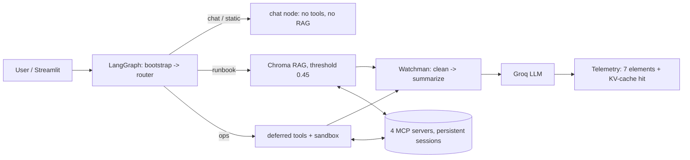

# OpsGate Context Copilot (v4)

v4 adds, on top of v3: a plug-and-play MCP registry (`mcp_servers.json`), live utility tools (weather, currency, time) + DuckDuckGo web search, hybrid RAG (dense + BM25 + RRF + FlashRank, gate >= 0.45),
self-healing escalation (RAG miss -> deferred MCP tool search -> live answer, else the Ignorance Clause), 3-tier cross-thread Mem0 memory, RBAC + human-in-the-loop approvals (`interrupt()`),
PII / prompt-injection guardrails, a FastAPI backend, OpenTelemetry/Langfuse tracing + `logs/audit.jsonl`, and a chat UI that runs **Naive vs OpsGate side by side on every message**.

```bash
pip install -r requirements.txt && cp .env.example .env     # add GROQ_API_KEY
python scripts/seed_db.py && python scripts/make_runbooks.py && python scripts/build_index.py
streamlit run app.py                                         # in-process
# or the split stack:
uvicorn api.server:app --port 8000 &  OPSGATE_API_URL=http://localhost:8000 streamlit run app.py
docker compose up --build                                    # API :8000, UI :8501, Qdrant :6333
python bench/eval_ragas.py                                   # writes bench/results_summary.md + .png
EMBEDDING_PROVIDER=hash SIM_THRESHOLD=0.2 RERANKER=none UTILITY_OFFLINE=1 pytest -q tests   # offline tests
```
Demo prompts: `How do I fix Error 5042?` (runbook) · `What is the weather in Delhi and convert 250 USD to INR?` (live MCP) · `Trigger rollback of payment-worker to v2.4.1` (approval banner; role must not be Viewer).
Add a server without code changes: edit `mcp_servers.json`, or use "+ Add MCP server" in the sidebar / `POST /v1/mcp/servers`. Web search needs `uv` and internet; if unavailable it is skipped.
See `docs/DONE.md` and `docs/TODO.md` for status. Below is the original v3 README.

---

# OpsGate Context Copilot

A LangGraph agent connected to 4 MCP servers (git, DB logs, incidents, runbook RAG) that demonstrates **context engineering**.
A Streamlit UI switches between a **naive baseline** and a **context-engineered** mode and shows tokens, tools loaded and retrieval status.

**Engineered mode:** three-case router, deferred tool loading, pagination + programmatic tool calling, thresholded contextual RAG,
lossless cleaning, lossy summarization, structured Mem0 memory (semantic / procedural / episodic), KV-cache-friendly prompt layout, XML delimiters.

Full design: `docs/BUILD_SPEC.md`. Project status and next steps: `HANDOFF.md`.

## Architecture


## Chat threads and attached files
- **Threads:** the sidebar lists your conversations (grouped Today / Yesterday / Previous 7 days / Older), each with its own colour gradient. `New chat` starts one; the `...` menu renames or deletes. Threads are saved in `data/threads/<user>.json`, so the list survives a refresh.
- **Auto titles:** after your first message the thread is named from its content (LLM title when `GROQ_API_KEY` is set, otherwise the first content words, e.g. `Fix Error 5042 Payment Worker`), refined once after the third message. Duplicates get `(2)`. A name you typed yourself is never overwritten.
- **Attach files:** use the paperclip in the chat box (pdf, txt, md, html, csv, json, log, docx; up to `MAX_UPLOAD_MB`). Files belong to the thread, are chunked like the runbooks, and a new `doc` route answers from them (similarity top-k, or an even sample for "summarise this"). Greeting and ops rules still win; if nothing in the files matches, runbooks are tried before giving up. Uploaded text is never cleaned, so dates and numbers stay exact.
- Needs `streamlit>=1.43` for the paperclip.

## KV caching (how the prompt is laid out)
Providers reuse work for an unchanged prompt **prefix**. So the prompt is built static-first:
`system base -> <reference> (SLA, catalog) -> user rules -> user facts -> tool schemas (fixed order) -> summary -> history -> <episodic_memory> -> <documents> -> <question>`.
No timestamps in the static part; memory lists are sorted and memoised; tools always bind in registry order. The UI shows the KV-cache hit (provider-reported when available, otherwise a prefix estimate), and `bench/results.csv` records `sent_tokens`, `cached_tokens` and `effective_tokens`.

## Optimisations in this version
Persistent MCP sessions, host-side router rules, sticky tool set, cached Chroma client / query embeddings / token counts, cleaner indentation fix, static SLA and catalog in the system prompt, summary-time memory extraction, turn-based summary trigger, 24-question benchmark, live naive-vs-engineered delta in the UI.

## Observability
- **Click any card's Details** in the UI: token elements per context part and the chosen route, the ordered tool-call list (args, ms, output tokens, status), retrieved chunks with scores, and every LLM call with sent/cached tokens. All local.
- **LangSmith (optional):** put `LANGSMITH_API_KEY` in `.env` (never in chat or git). Tracing turns on by itself. By default `LANGSMITH_REDACT=1`, so prompts and tool data are not uploaded, only structure and timings. No key = no tracing.
- **Output cap:** tool results are cleaned, then capped at `MAX_TOOL_OUTPUT_TOKENS` before they reach the model.

## Setup (VS Code)
```bash
python -m venv .venv && source .venv/bin/activate      # Windows: .venv\Scripts\activate
pip install -r requirements.txt
cp .env.example .env                                    # add GROQ_API_KEY
python scripts/seed_db.py
python scripts/make_runbooks.py
python scripts/build_index.py
streamlit run app.py
```
VS Code: open the folder, select the `.venv` interpreter, press F5 ("Streamlit app").

## Offline smoke test (no API key, no model download)
```bash
EMBEDDING_PROVIDER=hash SIM_THRESHOLD=0.2 pytest -q tests      # 30 tests + threads/uploads tests
```

## Benchmark
```bash
python bench/run_bench.py && python bench/plots.py     # needs GROQ_API_KEY; writes bench/results.csv + results.png
```
Put only numbers from `results.csv` in this README.

## Demo prompts
1. `Hi, who are you?`  2. `What is our policy on Lunar New Year holidays?`
3. `How do I fix Error 5042 in the payment worker? Show the Python retry script.`
4. `Check the last 200 failed orders, find which service threw errors, and show its latest commit.`
5. Session 2 (after "End session"): `Suggest a quick fix script.` to show remembered preferences.
